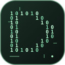

# DedsecAI Studio 0.4.1

**Скачать установщик:** [Windows EXE](https://github.com/Dedseckms/DedsecAI-Studio/releases/download/v0.4.1/DedsecAI-Studio-0.4.1-Setup.exe) · [Arch Linux](https://github.com/Dedseckms/DedsecAI-Studio/releases/download/v0.4.1/dedsecai-studio-0.4.1-1-any.pkg.tar.zst) · [Debian/Ubuntu](https://github.com/Dedseckms/DedsecAI-Studio/releases/download/v0.4.1/dedsecai-studio_0.4.1_all.deb) · [Все файлы и SHA-256](https://github.com/Dedseckms/DedsecAI-Studio/releases/tag/v0.4.1).

Предварительный релиз. Windows EXE собран и проверен на целостность; полная установка на Windows/Debian ещё требует приёмочной проверки. EXE не подписан. Для установки runtime/Pi нужен интернет; веса моделей скачиваются отдельно.

Локальный веб-собеседник, постоянная память, управление llama.cpp и запуск Pi в папке проекта.
Python 3.10+, Windows 10/11, Arch Linux и Debian/Ubuntu. Интерфейс: http://127.0.0.1:1236.

## Возможности

- Автоопределение CPU, RAM, GPU/VRAM и свободного диска. План профиля и пояснение ограничений для каждого ПК.
- Каталог из 36 подтверждённых вариантов Qwen, DeepSeek, GLM, Kimi, Gemma, Llama, Mistral, Phi.
- Поиск Hugging Face, выбор квантовки, докачка и SHA-256 при наличии ожидаемого хеша.
- Split GGUF: суммируются размеры, загружаются все части; локальный импорт проверяет наличие всех частей.
- Импорт собственного GGUF без копирования и загрузка по HTTPS-ссылке на один GGUF.
- Настраиваемый контекст для каждой модели; значение сохраняется и передаётся в Pi.
- Остановка и смена модели прерывают зависшую загрузку или ответ; отдельные журналы операций.
- Автозамер скорости после скачивания текстовой модели; прежняя активная модель затем восстанавливается.
- Vision: картинки в переписке, выбор и скачивание mmproj из Hugging Face, настройка локального проектора.
- Генерация изображений: отдельный stable-diffusion.cpp, рецепты SD/SDXL/FLUX/Qwen Image и другие, выбор компонентов, загрузка весов, PNG-галерея и автотест при загрузке модели.
- Терминальный интерфейс, анимации с учётом reduced motion, встроенные и собственные обои.
- История SQLite, автоматическое сохранение прямых фактов, «Запомни: …», редактируемая память и поиск по архиву.
- Настройки фильтров веб-собеседника: без дополнительных фильтров, умеренный, строгий, свой; общие и на модель.
- Модели и личные данные не входят в установщики. Никакая модель не скачивается без выбора пользователя.

## Установка

### Windows

Запустите `DedsecAI-Studio-0.4.1-Setup.exe` — мастер установки с выбором llama.cpp, Pi и автозапуска. Альтернатива: распакуйте Windows ZIP и запустите `installers\install-windows.cmd`.
Нужен Python 3.10+ с Tcl/Tk. При отсутствии подходящего Python/Tk/FTS5 установщик скачивает официальный Python 3.14.10, проверяет SHA-256 и Authenticode издателя и устанавливает его для текущего пользователя. winget не требуется.
Устанавливается готовый Vulkan runtime llama.cpp (либо CPU: PowerShell `-Backend cpu`), затем Pi и Node.js при необходимости.
В меню Пуск появляется DedsecAI Studio, сервер панели запускается при входе. Для отключения: `-NoAutostart`.
Windows CUDA: укажите собственный проверенный llama-server через `DEDSECAI_LLAMA_SERVER`; автоматический Windows-установщик использует Vulkan/CPU.

### Arch Linux

Распакуйте Arch архив: `bash installers/install-arch.sh`.
Для существующего llama-server достаточно Python/Tk; иначе ставятся инструменты сборки и Vulkan.
Вариант без сборки runtime: `bash installers/install-arch.sh --skip-runtime`.
Для нативного пакета есть `packaging/PKGBUILD`; готовность пакета зависит от наличия makepkg/fakeroot у сборщика.

### Debian / Ubuntu

Распакуйте Debian архив: `bash installers/install-debian.sh`.
Либо установите DEB: `sudo apt install ./dedsecai-studio_0.4.1_all.deb` и откройте приложение из меню.
DEB ставит приложение; runtime/Pi настраиваются кнопками в разделе «Система».
Скриптовый установщик ставит зависимости и настраивает runtime/Pi сразу.
Сборка llama.cpp из исходников использует glibc целевой системы — архив Ubuntu runtime не подставляется в старый Debian.
Драйвер видеокарты и Vulkan ICD должен быть установлен отдельно. Установщик не заменяет видеодрайверы.

### Общие параметры

`installers/install.py --skip-runtime --skip-pi --no-autostart --no-open` — установить только приложение.
`python cli.py setup-runtime --backend auto|cpu|vulkan|cuda` — настройка движка.
`python cli.py setup-pi` — отдельная установка Pi (Node >=22.19, пакет Pi закреплён на 1.1.0).
`python cli.py web` — открыть приложение, `python cli.py serve` — сервер переднего плана.
`python cli.py init --migrate` — перенести данные старого Qwen Studio, сохранив оригиналы.

## Железо и модели

Оценки не являются гарантией загрузки или точной скорости. Итоговый расход зависит от архитектуры, KV, вычислительных буферов, драйвера и других приложений.
На Windows объём AMD/Intel VRAM без nvidia-smi может остаться неизвестным; приложение честно показывает это и использует консервативный расчёт CPU.
NVIDIA определяется через nvidia-smi, AMD в Linux — через sysfs. Неизвестная/разделяемая память не выдаётся за гарантированную VRAM.
Загруженный GGUF уточняет архитектуру и параметры кэша. MLA/SSM/hybrid оцениваются приблизительно.
Измеренная скорость привязана к профилю и отпечатку оборудования, не переносится на другой компьютер.
Kimi K2 — сотни ГиБ весов. MoE active parameters не заменяют полный размер. Не подходящие ПК варианты отмечаются явно.
У каждого GGUF своя лицензия и требования к версии llama.cpp. Каталог подтверждает наличие файлов, а не качество всех моделей.
Для закрытых Hugging Face репозиториев задайте `HF_TOKEN` и примите условия в источнике.
Для текстовых и vision-моделей нужен GGUF. Для генерации stable-diffusion.cpp принимает совместимые GGUF/safetensors/ckpt и отдельные энкодеры/VAE по рецепту. Один diffusion GGUF обычно не включает все компоненты.

## Чаты собеседника

Переписка и список чатов прокручиваются независимо в пределах окна; поле ввода остаётся снизу. На узком экране список открывается кнопкой «Чаты». Обновление ответа сохраняет позицию чтения, когда вы прокрутили историю вверх.
У чата есть кнопка «×» для удаления с подтверждением. Чат перемещается в корзину, скрывается из истории и поиска и может быть восстановлен вместе с вложениями. Отдельно сохранённые записи «Памяти» остаются доступными. Перед удалением чата с текущим ответом нужно остановить генерацию.

## Мастерская изображений и GPU

Общая верхняя панель показывает модели, о которых сообщают работающие API, и расход VRAM процессов NVIDIA, когда драйвер отдаёт эти данные. Выбранная в каталоге модель не считается загруженной. Общая занятая VRAM включает рабочий стол и другие приложения; она не приписывается целиком нейросети. Для каждого движка есть отдельная кнопка выгрузки.

В «Изображениях» разделены «Мои модели», «Каталог» и поиск Hugging Face. Можно скачать модель, не переключая работающего собеседника, или скачать и сразу запустить. Встроенный каталог содержит SD Turbo, SD 1.5, SDXL Turbo и Qwen Image 2.1 Uncensored Q4/Q5/Q6/Q8. Uncensored — метка автора, не гарантия отсутствия отказов или определённого содержания. Поиск исключает явно размеченные энкодеры/LoRA; форматы MLX/NVFP4 и split-веса не предлагаются как самостоятельные модели для этого runtime. Совместимость произвольной сторонней сборки всё равно зависит от архитектуры и компонентов.

У картинки есть «Сохранить» и «Удалить». Удаление требует подтверждения и перемещает PNG в локальную корзину; вкладка «Корзина» восстанавливает файл и запись галереи. Отдельная блокировка защищает индекс при одновременной генерации и удалении. Модель записывается в метаданные новых изображений; у старых неизвестная модель не угадывается. Ваши картинки не удаляются при обновлении.

Если после генерации вы работали в текстовом чате, следующая генерация загружает последний выбранный генератор. Переключение освобождает другой движок. Оба серверных API остаются на loopback.

## Контекст и картинки

В Обзоре нажмите «Изменить контекст», либо «Настроить» на карточке модели. Предел берётся из GGUF; выбранное окно может не поместиться в память ПК. Интерфейс показывает приблизительный KV-кэш, а не гарантию запуска. Активная модель перезапустится; Pi получит новый размер окна при следующем запуске.
Vision-модель и её проектор должны соответствовать друг другу. При импорте Hugging Face выбирайте mmproj; у локальной модели укажите полный путь в профиле. До четырёх PNG/JPEG/WebP до 6 МиБ сохраняются вместе с сообщением. Для картинок резервируется дополнительный контекст. Точное число image-токенов зависит от модели.

Во вкладке «Изображения» выберите SD Turbo, SD 1.5 или SDXL Turbo и нажмите «Скачать и запустить». Движок, рецепт и основной файл подключаются автоматически. Каталог показывает объём загрузки и ориентир по GPU вашего ПК. Ссылка не требуется.
Свой GGUF/safetensors/ckpt можно добавить кнопкой «Выбрать файл с компьютера». Известные типы распознаются автоматически; для составных моделей подбираются однозначно подходящие компоненты из библиотеки, а недостающие перечисляются явно. Для Qwen Image 2.1 и Turbo недостающие Qwen3-VL-8B Q4_K_M и VAE 2.1 скачиваются и подключаются автоматически по закреплённым ревизиям и SHA-256. В карточке указан дополнительный объём. Полный VAE не скачивается, если уже выбран подходящий TAE. Проверяются также группы «нужен хотя бы один компонент», например VAE/TAE.
Рецепт, компоненты и прямые ссылки остаются в свёрнутых дополнительных настройках. Из каталога импортированный image-GGUF можно подключить кнопкой «В изображения»: создаётся hard link, оригинал сохраняется. При импорте между разными дисками файл копируется после проверки свободного места; оригинал сохраняется. Рецепты берутся из закреплённого runtime.
Скорость генератора проверяется реальным изображением после загрузки всех компонентов. Автозамеры можно прервать кнопкой остановки. Запуск генератора освобождает текстовую модель; запуск текстовой модели останавливает генератор. Image-runtime устанавливается отдельно кнопкой: x64 Windows и Linux, CPU/Vulkan.

## Автоматическая память

По умолчанию новые сообщения проверяются на прямые утверждения об имени, месте проживания, работе, языке ответов и предпочтениях. Сохраняются слова пользователя с источником сообщения, а не догадки модели. Вопросы, примеры и сообщения с очевидными секретами пропускаются; это эвристика, а не распознавание всех личных данных. Память можно отключить или исправить во вкладке «Память». Исправленную вручную запись автообновление не перезаписывает. Изменения автоматических записей сохраняются в истории БД.
Память общая для моделей. Это не обучение весов и не полное понимание всей биографии; сложный факт можно добавить через «Запомни: …» или вручную. Старые сообщения задним числом автоматически не обрабатываются.

## Фильтры

Режим «Без фильтров приложения» отключает проверки Studio, но не удаляет обученные отказы из весов.
Списки тем/слов — эвристика: возможны пропуски и ложные срабатывания; стопроцентный тематический запрет не обещается.
При ограничениях ответ буферизуется, проверяется и только затем показывается. Запрещённый запрос не добавляется в чат.
Политики действуют только в веб-собеседнике. Прямой API llama.cpp и Pi обходят эти проверки.
Изменение правил не стирает историю или память и применяется к следующим сообщениям.

## Данные и перенос

Linux: `${XDG_DATA_HOME:-~/.local/share}/dedsecai-studio`; Windows: `%LOCALAPPDATA%\DedsecAI Studio`.
Переменная `DEDSECAI_HOME` меняет каталог данных; код установки хранится в `app/`, данные отдельно.
`config/`, `state/`, `models/`, `image-models/`, `gallery/`, `companion/companion.sqlite3` — настройки, журналы, модели и переписка.
Локальный импорт ссылается на файл в исходной папке. При переносе ПК путь нужно выбрать заново.
Панель доступна только на loopback; действия проверяют Host, Origin и CSRF-токен. Прямой llama.cpp API слушает loopback отдельно.
Старые файлы не удаляются при миграции. Перед обновлением пользовательской установки создаётся копия кода.

## Сборка и проверка

`python build.py` создаёт ZIP Windows, tar.gz Arch/Debian, DEB и SHA256SUMS в dist/.
`python -m unittest discover -s tests -v` — проверки без загрузки весов.
Полные приёмочные проверки Windows и Debian в этой Linux-среде не выполнялись. Скрипты/формат пакетов проверяются здесь, а запуск на целевой ОС требует отдельного тестирования.
Установщики не подписаны Authenticode и не содержат веса, токены, личные настройки или переписку.
Сборка llama.cpp/скачивание runtime и Pi требует интернета. На слабом ПК сборка занимает заметное время.

Источники: https://github.com/leejet/stable-diffusion.cpp, https://github.com/ggml-org/llama.cpp, https://huggingface.co, https://nodejs.org, https://github.com/earendil-works/pi.

## Windows EXE

Это настоящий Unicode NSIS online-установщик, не переименованный ZIP. Компоненты llama.cpp, Pi/Node и автозапуск включены по умолчанию и отключаются в мастере.
Архитектуры: Windows 10/11 x64 или ARM64. Сам загрузчик NSIS x86 работает через системную совместимость; скачиваемые Python/Node/llama выбираются под ОС.
Нужен интернет. Python/движок/Pi скачиваются по необходимости, веса моделей отдельно.
Мастер создаёт запись в «Установленных приложениях» и удаление программы с подтверждением. Удаление сохраняет модели, историю, память и скачанные runtimes.
Журнал установки: `%LOCALAPPDATA%\DedsecAI Studio\state\windows-setup.log`.
EXE не подписан Authenticode. Полная установка на настоящей Windows пока не проверена.
Сборка EXE: `python installers/build-windows.py --makensis /путь/к/makensis` (NSIS 3; при переносимой Linux-сборке задайте NSISDIR).
