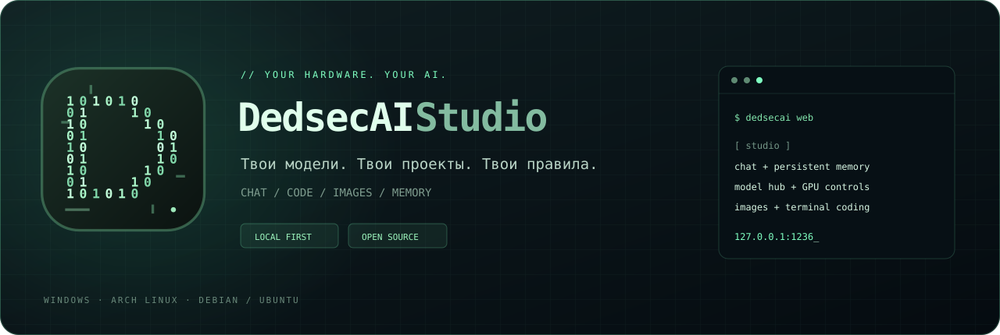
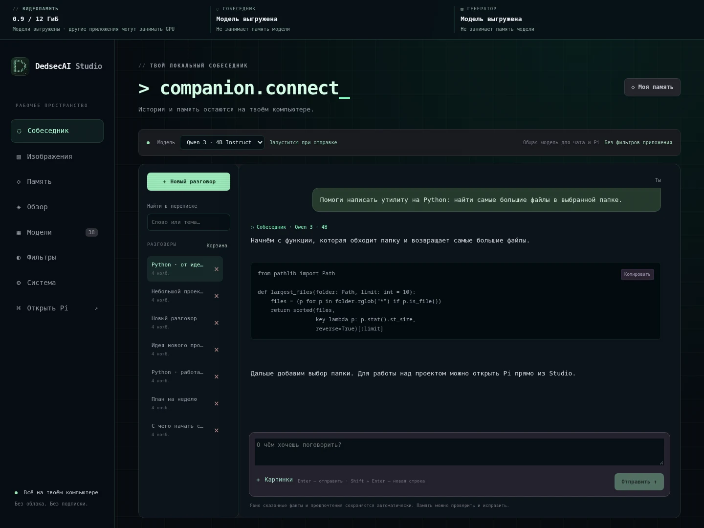

# DedsecAI Studio v@VERSION@

Локальная AI-мастерская: собеседник с памятью, терминальный Pi, свои GGUF-модели и генерация изображений.

## Скачать

| Windows | Arch Linux | Debian / Ubuntu |
| :---: | :---: | :---: |
| [**↓ Установщик EXE**](https://github.com/Dedseckms/DedsecAI-Studio/releases/download/v@VERSION@/DedsecAI-Studio-@VERSION@-Setup.exe) | [**↓ Пакет pacman**](https://github.com/Dedseckms/DedsecAI-Studio/releases/download/v@VERSION@/dedsecai-studio-@VERSION@-1-any.pkg.tar.zst) | [**↓ Пакет DEB**](https://github.com/Dedseckms/DedsecAI-Studio/releases/download/v@VERSION@/dedsecai-studio_@VERSION@_all.deb) |
| [ZIP + скрипт](https://github.com/Dedseckms/DedsecAI-Studio/releases/download/v@VERSION@/DedsecAI-Studio-@VERSION@-windows.zip) | [Установщик tar.gz](https://github.com/Dedseckms/DedsecAI-Studio/releases/download/v@VERSION@/DedsecAI-Studio-@VERSION@-arch.tar.gz) | [Установщик tar.gz](https://github.com/Dedseckms/DedsecAI-Studio/releases/download/v@VERSION@/DedsecAI-Studio-@VERSION@-debian.tar.gz) |

[SHA-256](https://github.com/Dedseckms/DedsecAI-Studio/releases/download/v@VERSION@/SHA256SUMS) · [Полное руководство](https://github.com/Dedseckms/DedsecAI-Studio#guide) · [Сообщить об ошибке](https://github.com/Dedseckms/DedsecAI-Studio/issues/new/choose)

## Что нового в v@VERSION@

- Установщик Windows оформлен в стиле Studio: тёмная палитра, зелёные акценты, двоичный логотип и русские подписи компонентов.
- Новая Windows-иконка для установщика, удаления программы и ярлыков в меню «Пуск» и на рабочем столе.
- Исправлено определение VRAM NVIDIA при дробной температуре и недоступных датчиках. AMD, Intel и NVIDIA определяются через Windows DXGI; разделяемая RAM учитывается отдельно.
- Исправлен запуск Pi из фоновой Windows-панели: консольный Python и прямой запуск JS через Node.js.
- Автоматическая сборка шести пакетов, проверка установки EXE и единое оформление следующих релизов.

Реальный интерфейс с демонстрационными данными; личные переписки не включены.

## В Studio также доступны

Контекст для каждой модели, каталог Hugging Face и Uncensored-сборок с пояснениями, мастерская изображений с галереей и корзиной, управление GPU/VRAM и запуск Pi в выбранном проекте. Для Qwen Image 2.1 автоматически подключаются совместимые энкодер и VAE.

## Проверки

Тесты и реальный запуск панели выполняются на Ubuntu и Windows. EXE проходит тихую установку ядра программы на Windows с последующим запуском установленной панели. Контрольные суммы шести пакетов собраны в SHA256SUMS.

Ранняя версия проекта. EXE не подписан. GPU проверен на RTX 3060 12 ГиБ; другие карты требуют проверки с их драйверами. Тихая проверка установки не скачивает движки и модели и не заменяет визуальную приёмку всех страниц мастера. Для загрузки runtime/Pi и весов нужен интернет; личные данные и модели в установщики не входят.
